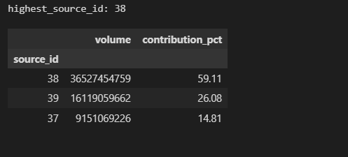
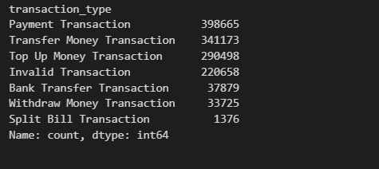

# Data Wrangling Project – E-Wallet Payments & Transactions

Exploratory data analysis and data wrangling on payment reports and ~1.3 million transaction records from an e-wallet platform, using **Python**, **pandas** and **NumPy**.

## Problem Statement

Acting as a Data Analyst at an e-wallet company, the goal is to understand the state of payments and transactions on the platform: assess data quality, then answer business questions about product performance, team ownership, refunds and transaction types.

## Dataset

| File | Rows | Description |
|------|------|-------------|
| `payment_report.csv` | 919 | Monthly payment volume by product and source (Jan – Apr 2023) |
| `product.csv` | – | Product master data: category and owning team for each `product_id` |
| `transactions.csv` | 1,324,002 | Transaction-level data (1 – 7 May 2023, UTC+7) |

**Columns**

- `payment_report.csv`: `report_month`, `payment_group` (payment / refund), `product_id`, `source_id`, `volume`
- `product.csv`: `product_id`, `category`, `team_own`
- `transactions.csv`: `transaction_id`, `merchant_id`, `volume`, `transType`, `transStatus`, `sender_id`, `receiver_id`, `extra_info`, `timeStamp` (Unix time in milliseconds)

## Project Structure

```
Data_wrangling_project/
├── data_wrangling_project.ipynb   # Main notebook
├── raws.zip                       # Raw datasets (extracts to raws/)
│   ├── payment_report.csv
│   ├── product.csv
│   └── transactions.csv
├── images/                        # Result screenshots
├── .gitignore
└── README.md
```

## Part I – Exploratory Data Analysis

`payment_report` was enriched with `product` (left join on `product_id`) to create `payment_enriched`.

| Check | `payment_enriched` | `transactions` |
|-------|--------------------|----------------|
| Data types | `report_month` → `datetime` | `timeStamp` (Unix ms) → `datetime` |
| Missing data | 22 rows missing `category` / `team_own` (product_id 3, 1976, 10033 not in `product.csv`) → **No action** | `sender_id` 49,059, `receiver_id` 164,795, `extra_info` ~99.5% → **No action** (optional fields) |
| Incorrect values | No negative or zero volume → **No action** | 3 rows with negative `receiver_id`; ~75k rows with negative `transStatus` (failed transactions) → **No action**, flagged |
| Duplicates | No exact duplicates → **No action** | PK `transaction_id`: 28 duplicate rows → **Delete rows** |

## Part II – Data Wrangling

1. **Top 3 product_ids by payment volume.**
   → **429**, **372**, **431**.

   

2. **Product ownership check** – verify that each `product_id` belongs to only one team.
   → No abnormal products found.

   

3. **Lowest-performing team since Q2 2023** and the category contributing the least to it (data ends in April 2023, so Q2 covers April only).
   → Team **APS**, category **PXXXXXE**.

   

4. **Refund contribution by `source_id`** (`payment_group = "refund"`).
   → `source_id` **38** contributes the most (59.11%), followed by 39 (26.08%) and 37 (14.81%).

   

5. **Classify transactions** into a new `transaction_type` column using `np.select`:

   | Condition | Transaction type |
   |-----------|------------------|
   | `transType = 2` & `merchant_id = 1205` | Bank Transfer Transaction |
   | `transType = 2` & `merchant_id = 2260` | Withdraw Money Transaction |
   | `transType = 2` & `merchant_id = 2270` | Top Up Money Transaction |
   | `transType = 2` & other merchants | Payment Transaction |
   | `transType = 8` & `merchant_id = 2250` | Transfer Money Transaction |
   | `transType = 8` & other merchants | Split Bill Transaction |
   | Remaining cases | Invalid Transaction |

   

6. **Summary by transaction type** (excluding invalid transactions):

   | Transaction type | Transactions | Total volume | Senders | Receivers |
   |------------------|-------------:|-------------:|--------:|----------:|
   | Bank Transfer | 37,879 | 50,605,806,190 | 23,156 | 9,271 |
   | Payment | 398,665 | 71,850,608,441 | 139,583 | 113,298 |
   | Split Bill | 1,376 | 4,901,464 | 1,323 | 572 |
   | Top Up Money | 290,498 | 108,605,618,829 | 110,409 | 110,409 |
   | Transfer Money | 341,173 | 37,032,880,492 | 39,021 | 34,585 |
   | Withdraw Money | 33,725 | 23,418,181,420 | 24,814 | 24,814 |

   *Senders/receivers are unique IDs. 220,658 rows are classified as Invalid Transaction.*

   

   Success rate (`transStatus = 1`): Top Up 82.74%, Payment 94.96%, Bank Transfer 96.41%, Withdraw 99.91%, Transfer 99.95%, Split Bill 100%.

   

## Key Insights

- Products **429** and **372** lead payment volume (Jan – Apr 2023). Product **1976** carries all refund volume but is missing from `product.csv`, so the product master data should be completed.
- Since Q2 2023, team **APS** has by far the lowest volume; category PXXXXXE contributes the least, very close to PXXXXXS.
- `source_id` **38** accounts for ~59% of refund volume and is the first place to investigate.
- In 1 – 7 May 2023, **Top Up** has the highest volume while **Payment** has the most transactions and users. About **16.7%** of rows match no defined transaction type, and Top Up has the lowest success rate.

## Tech Stack

- Python 3
- pandas
- NumPy
- Jupyter Notebook / Google Colab

## How to Run

1. Clone the repository:
   ```bash
   git clone https://github.com/<your-username>/Data_wrangling_project.git
   cd Data_wrangling_project
   ```
2. Install dependencies:
   ```bash
   pip install pandas numpy jupyter
   ```
3. Extract the raw data into the `raws/` folder:
   ```bash
   unzip raws.zip
   ```
   The notebook reads data from `raws/` via `DATA_DIR` in the first cell. On Google Colab, set it to your Drive folder instead:
   ```python
   DATA_DIR = "/content/drive/MyDrive/PyThon_Project2"
   ```
4. Open and run the notebook:
   ```bash
   jupyter notebook data_wrangling_project.ipynb
   ```
