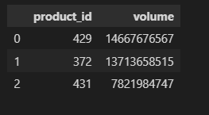
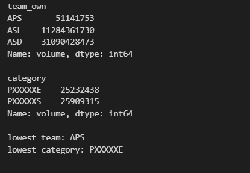
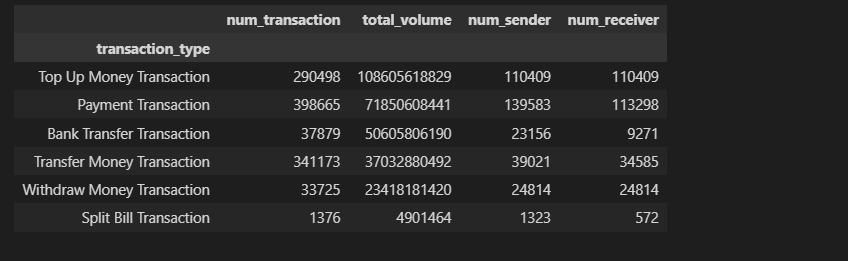
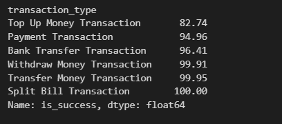

# 📊 Payment Performance, Refund Sources & Transaction Mix of an E-Wallet Platform | Python (pandas, NumPy)

_Assess data quality and answer business questions on payment volume, team ownership, refunds and transaction types for an e-wallet company._

- **Business question:** Which products and teams drive (or lag in) payment volume, where do refunds come from, and what does the transaction mix and success rate look like?
- **Domain:** Fintech / e-wallet payments

Author: Hoàng Văn Hiếu
Date: 2026-11-04
Tools Used: Python (pandas, NumPy), Jupyter Notebook / Google Colab

---

## 📑 Table of Contents

1. [📌 Background & Overview](#-background--overview)
2. [📂 Dataset Description & Data Structure](#-dataset-description--data-structure)
3. [⚒️ Main Process](#️-main-process)
4. [🔎 Final Conclusion & Recommendations](#-final-conclusion--recommendations)

---

## 📌 Background & Overview

### 📖 What is this project about? What Business Question will it solve?

Acting as a Data Analyst at an e-wallet company, this project uses Python to explore and wrangle monthly payment reports and ~1.3 million transaction records in order to:

✔️ Check data quality (types, missing values, wrong values, duplicates) before any analysis.
✔️ Find the top products by payment volume and verify the rule "one product belongs to one team".
✔️ Identify the lowest-performing team since Q2 2023 and the category dragging it down.
✔️ Find which `source_id` contributes most to refunds.
✔️ Classify every transaction into a business type and compare volume, users and success rate across types.

### 👤 Who is this project for?

✔️ Product and business teams owning e-wallet products
✔️ Operations / risk teams investigating refunds and failed transactions
✔️ Data analysts looking for a pandas data-wrangling example on payment data

---

## 📂 Dataset Description & Data Structure

### 📌 Data Source

- **Source:** Internal e-wallet datasets provided for the exercise ([`raws.zip`](raws.zip))
- **Size:** `payment_report.csv` 919 rows; `product.csv` product master; `transactions.csv` 1,324,002 rows
- **Period:** payments Jan – Apr 2023; transactions 1 – 7 May 2023 (UTC+7)
- **Format:** .csv

### 📊 Data Structure & Relationships

#### 1️⃣ Tables Used

All 3 tables are used. `payment_report` is joined with `product` (left join on `product_id`) to create `payment_enriched`; `transactions` is analyzed on its own.

#### 2️⃣ Table Schema & Data Snapshot

Table 1: `payment_report.csv`: monthly payment volume by product and source

| Column Name | Data Type | Description |
|---|---|---|
| `report_month` | DATE | Reporting month |
| `payment_group` | TEXT | `payment` or `refund` |
| `product_id` | INT | Product ID (joins to `product.csv`) |
| `source_id` | INT | Payment source |
| `volume` | INT | Payment volume |

Table 2: `product.csv`: product master data

| Column Name | Data Type | Description |
|---|---|---|
| `product_id` | INT | Product ID |
| `category` | TEXT | Product category |
| `team_own` | TEXT | Team that owns the product |

Table 3: `transactions.csv`: transaction-level data

<details>
<summary>Click to expand</summary>

| Column Name | Data Type | Description |
|---|---|---|
| `transaction_id` | INT | Unique transaction ID (primary key) |
| `merchant_id` | INT | Merchant ID |
| `volume` | INT | Transaction amount |
| `transType` | INT | Transaction type code (2 or 8 are valid) |
| `transStatus` | INT | 1 = success, other values = failed |
| `sender_id` | INT | Sender ID (optional) |
| `receiver_id` | INT | Receiver ID (optional) |
| `extra_info` | TEXT | Extra information (optional) |
| `timeStamp` | INT | Unix time in milliseconds |

</details>

---

## ⚒️ Main Process

1️⃣ Data Cleaning & Preprocessing → 2️⃣ Exploratory Data Analysis → 3️⃣ Python Analysis (6 business tasks)

### Part I: Data Cleaning & EDA

Before answering any question, both datasets were checked for the four common quality issues: wrong data types, missing data, incorrect values and duplicates. The goal is to fix only what would distort results and keep everything else.

```python
payment_enriched = payment_report.merge(products, on="product_id", how="left")
payment_enriched["report_month"] = pd.to_datetime(payment_enriched["report_month"])

# Unix ms (UTC) -> Vietnam time
transactions["timeStamp"] = (
    pd.to_datetime(transactions["timeStamp"], unit="ms")
    .dt.tz_localize("UTC").dt.tz_convert("Asia/Ho_Chi_Minh").dt.tz_localize(None)
)
transactions[["sender_id", "receiver_id"]] = transactions[["sender_id", "receiver_id"]].astype("Int64")

# 28 exact duplicates on the primary key
transactions = transactions.drop_duplicates()
```

| Check | `payment_enriched` | `transactions` |
|---|---|---|
| Data types | `report_month` → `datetime` | `timeStamp` (Unix ms) → `datetime` UTC+7; `sender_id`, `receiver_id` → nullable integer |
| Missing data | 22 rows missing `category` / `team_own` (product_id 3, 1976, 10033 not in `product.csv`) → **No action**, volume is valid | `sender_id` 49,059, `receiver_id` 164,795, `extra_info` ~99.5% → **No action** (optional fields) |
| Incorrect values | No negative or zero volume → **No action** | 3 rows with negative `receiver_id`; `transStatus` ≠ 1 marks failed transactions (~5.7%) → **No action**, kept for analysis |
| Duplicates | No exact duplicates; 5 rows repeat the key but are separate refunds of product 1976 → **No action** | 28 duplicate rows on `transaction_id` → **Deleted** |

**Observation:** Product **1976** carries all refund rows but is missing from the product master, an upstream data issue worth reporting.

---

### Part II: Business Tasks

#### Task 1: Top 3 products by payment volume

Payment volume shows which products drive the business. Only `payment_group = "payment"` is counted, since refunds are money going back, not sales.

```python
top_products = (
    payment_enriched[payment_enriched["payment_group"] == "payment"]
    .groupby("product_id")["volume"].sum()
    .nlargest(3).reset_index()
)
```

| product_id | volume |
|---|---:|
| 429 | 14,667,676,567 |
| 372 | 13,713,658,515 |
| 431 | 7,821,984,747 |



**Observation:** Products **429** and **372** are far ahead; together they are almost 4× the volume of the third product.

---

#### Task 2: Is every product owned by only one team?

The business rule says one product belongs to one team. A product mapped to several teams would make team performance double-counted.

```python
team_per_product = payment_enriched.groupby("product_id")["team_own"].nunique()
team_per_product[team_per_product > 1]
```


**Observation:** No product is owned by more than one team, so team-level reporting is reliable.

---

#### Task 3: Lowest-performing team since Q2 2023, and its weakest category

This finds which team needs attention. The data ends in April 2023, so "since Q2 2023" covers April only; rows without `team_own` are excluded.

```python
q2 = payment_enriched[payment_enriched["report_month"] >= "2023-04-01"]
team_volume = q2.groupby("team_own")["volume"].sum().sort_values()
lowest_team = team_volume.idxmin()
category_volume = (q2[q2["team_own"] == lowest_team]
                   .groupby("category")["volume"].sum().sort_values())
```

| team_own | volume (Apr 2023) |
|---|---:|
| **APS** | **51,141,753** |
| ASL | 11,284,361,730 |
| ASD | 31,090,428,473 |

| category (team APS) | volume |
|---|---:|
| **PXXXXXE** | **25,232,438** |
| PXXXXXS | 25,909,315 |



**Observation:** Team **APS** is far behind (about 0.5% of ASL's volume). Its two categories are nearly equal, so the gap is team-wide rather than caused by one weak category.

---

#### Task 4: Which `source_id` contributes most to refunds?

Refunds cost money and often signal failed or disputed payments. Knowing which source drives them tells operations where to investigate first.

```python
refund = payment_enriched[payment_enriched["payment_group"] == "refund"]
refund_by_source = refund.groupby("source_id")["volume"].sum().sort_values(ascending=False).to_frame()
refund_by_source["contribution_pct"] = (refund_by_source["volume"] / refund_by_source["volume"].sum() * 100).round(2)
```

| source_id | volume | contribution (%) |
|---|---:|---:|
| **38** | 36,527,454,759 | **59.11** |
| 39 | 16,119,059,662 | 26.08 |
| 37 | 9,151,069,226 | 14.81 |


**Observation:** `source_id` **38** alone accounts for **59%** of refund volume.

---

#### Task 5: Classify transactions by type

Raw codes (`transType`, `merchant_id`) are not readable for business users. Mapping them to named transaction types makes the rest of the analysis possible. `np.select` applies the rules in order:

| Condition | Transaction type |
|---|---|
| `transType = 2` & `merchant_id = 1205` | Bank Transfer Transaction |
| `transType = 2` & `merchant_id = 2260` | Withdraw Money Transaction |
| `transType = 2` & `merchant_id = 2270` | Top Up Money Transaction |
| `transType = 2` & other merchants | Payment Transaction |
| `transType = 8` & `merchant_id = 2250` | Transfer Money Transaction |
| `transType = 8` & other merchants | Split Bill Transaction |
| Remaining cases | Invalid Transaction |

```python
conditions = [
    (transactions["transType"] == 2) & (transactions["merchant_id"] == 1205),
    (transactions["transType"] == 2) & (transactions["merchant_id"] == 2260),
    (transactions["transType"] == 2) & (transactions["merchant_id"] == 2270),
    (transactions["transType"] == 2),
    (transactions["transType"] == 8) & (transactions["merchant_id"] == 2250),
    (transactions["transType"] == 8),
]
choices = ["Bank Transfer Transaction", "Withdraw Money Transaction", "Top Up Money Transaction",
           "Payment Transaction", "Transfer Money Transaction", "Split Bill Transaction"]
transactions["transaction_type"] = np.select(conditions, choices, default="Invalid Transaction")
```

| transaction_type | rows |
|---|---:|
| Payment Transaction | 398,665 |
| Transfer Money Transaction | 341,173 |
| Top Up Money Transaction | 290,498 |
| Invalid Transaction | 220,658 |
| Bank Transfer Transaction | 37,879 |
| Withdraw Money Transaction | 33,725 |
| Split Bill Transaction | 1,376 |


**Observation:** **220,658 rows (~16.7%)** match no defined type, a large share that needs explaining before these rules are used in reporting.

---

#### Task 6: Volume, users and success rate by transaction type

Comparing transactions, volume, unique senders/receivers and success rate across types shows which services are used most, which carry the most money, and which fail most often.

```python
valid = transactions[transactions["transaction_type"] != "Invalid Transaction"]
result = valid.groupby("transaction_type").agg(
    num_transaction=("transaction_id", "count"),
    total_volume=("volume", "sum"),
    num_sender=("sender_id", "nunique"),
    num_receiver=("receiver_id", "nunique"),
).sort_values("total_volume", ascending=False)

success_rate = (valid.assign(is_success=valid["transStatus"] == 1)
                .groupby("transaction_type")["is_success"].mean().mul(100).round(2))
```

| Transaction type | Transactions | Total volume | Senders | Receivers | Success rate |
|---|---:|---:|---:|---:|---:|
| Top Up Money | 290,498 | 108,605,618,829 | 110,409 | 110,409 | **82.74%** |
| Payment | 398,665 | 71,850,608,441 | 139,583 | 113,298 | 94.96% |
| Bank Transfer | 37,879 | 50,605,806,190 | 23,156 | 9,271 | 96.41% |
| Transfer Money | 341,173 | 37,032,880,492 | 39,021 | 34,585 | 99.95% |
| Withdraw Money | 33,725 | 23,418,181,420 | 24,814 | 24,814 | 99.91% |
| Split Bill | 1,376 | 4,901,464 | 1,323 | 572 | 100% |




**Observation:** **Top Up** carries the most money but has the **lowest success rate (82.7%)**: about 1 in 6 top-ups fails. **Payment** has the most transactions and the most users. Split Bill is barely used.

---

## 🔎 Final Conclusion & Recommendations

👉🏻 Based on the insights and findings above, we would recommend the **Product, Operations and Data teams** to consider the following:

📍 Key Takeaways:
✔️ **Fix Top Up reliability first.** It is the highest-volume service yet fails ~17% of the time, which directly loses money and users.
✔️ **Investigate refunds from `source_id` 38** (59% of refund volume) and add product 1976, which carries all refunds, to the product master.
✔️ **Review team APS**, whose April volume is a fraction of the other teams across both of its categories.
✔️ **Clarify the 16.7% "Invalid" transactions** with the business before using these type rules in production reports.

<details>
<summary>How to run & project structure (click to expand)</summary>

```bash
git clone https://github.com/hoangvanhieu2004/Data-Wrangling-E-Wallet-Payments-Transactions.git
cd Data-Wrangling-E-Wallet-Payments-Transactions
pip install pandas numpy jupyter
unzip raws.zip            # extracts payment_report.csv, product.csv, transactions.csv into raws/
jupyter notebook data_wrangling_project.ipynb
```

The notebook reads data from `raws/` via `DATA_DIR` in the first cell. On Google Colab, set it to your Drive folder instead, e.g. `DATA_DIR = "/content/drive/MyDrive/PyThon_Project2"`.

```text
.
├── data_wrangling_project.ipynb   # Main notebook
├── raws.zip                       # Raw datasets
├── images/                        # Result screenshots
└── README.md
```

</details>
